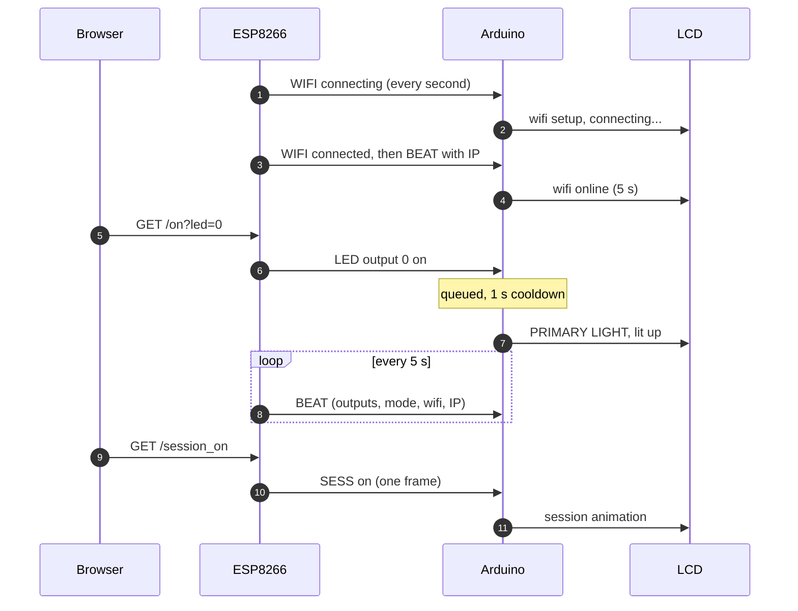
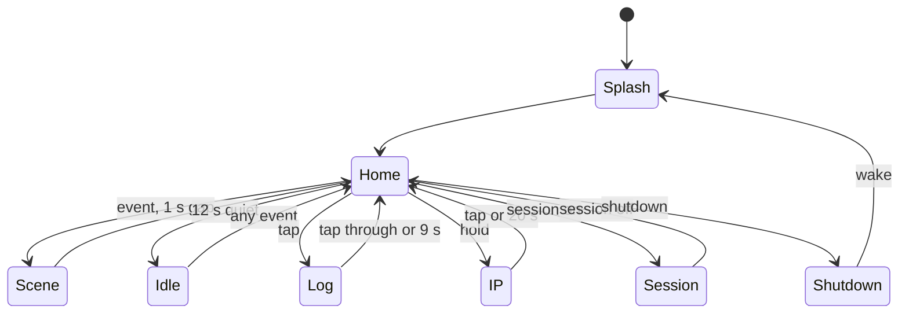

<div align="center">


<br>


**Switch five outputs from your browser and watch a tiny LCD react in real time.**
The ESP8266 reports what happens. The Arduino owns every word and animation.

[Highlights](#-highlights) ·
[Architecture](#-architecture) ·
[Display](#-what-the-display-shows) ·
[Wiring](#-wiring) ·
[Quick start](#-quick-start) ·
[Protocol](#-wire-protocol) ·
[Troubleshooting](#-troubleshooting)

</div>

---

## ✨ Highlights

| | |
|---|---|
| 🌐 **Web control** | Five outputs from any phone or PC. The page loads already matching the real board state. |
| 📺 **Live LCD** | The display follows the ESP in real time: connecting, online, output on or off, session, shutdown, wake. |
| 🔗 **One-way binary link** | Short, checksummed frames from ESP to Arduino. The Arduino never talks back, so the link stays calm. |
| 🚦 **Calm display** | Events queue up and play one at a time with a **1 s cooldown**, so rapid toggling never rushes the screen. |
| ⚡ **Session and 🌙 Shutdown** | Each has its own web view, its own single command, and its own LCD animation. Switching outputs by hand never triggers them. |
| 🔘 **Physical button** | **Tap** for the output log, **hold** for Wi-Fi status then the IP address (20 s). |
| 🩹 **Self-healing** | A heartbeat every 5 s carries the IP and state. If the Arduino resets or misses an event, it recovers silently. |
| 🧹 **Silent clean-up** | Every 10 minutes the Arduino tidies its data without a reboot, and the animations never notice. |
| 🎵 **Cozy idle** | 30 messages and four rotating animations: floating note, twinkle, dot wave, drifting moon. |

---

## 🏗 Architecture

<div align="center">

</div>

The ESP8266 is a **sender**. The Arduino is a **receiver and display unit**. There is one wire between them.

<details>
<summary><b>What each side is responsible for</b></summary>

<br>

**ESP8266 (sender)**

- Handles web requests instantly. There is no `delay()` in any handler.
- Turns every event into a small frame in a non-blocking queue, sent one frame at a time with a 30 ms gap.
- **Drops obsolete frames** so nothing builds up:
  - A new toggle replaces the queued toggle for the same output.
  - Session drops queued toggles.
  - Shutdown drops queued toggles, session frames and heartbeats.
  - Duplicate Wi-Fi and heartbeat frames collapse into one.
- Sends a **heartbeat** every 5 s (every 30 s during shutdown). It waits for a quiet line but is never more than 2 s late.
- Notices Wi-Fi changes within 500 ms and reports them immediately.

**Arduino (display unit)**

- Never transmits to the ESP. Its TX pin only prints status lines for the IDE serial monitor.
- A **resyncing parser** validates header, length and checksum. A bad checksum drops one byte and rescans, so ESP boot garbage and line noise cannot corrupt anything.
- **Reads serial during every animation step**, so no frame is ever lost, even in a 5 s shutdown animation.
- Draws through a frame buffer and writes only the cells that changed, which is smoother and flickers less.
- Holds an 8-event queue that de-duplicates, and leaves the log or IP view with only the newest queued toggle, so old toggles are not replayed.

</details>

### Event lifecycle



### Display modes



---

## 📺 What the display shows

<div align="center">

</div>

<details>
<summary><b>Scene details</b></summary>

<br>

| Scene | What happens |
|---|---|
| **Boot splash** | Mirrored bar fill, curtain close, spark sprinkle, typewriter text, progress bar, flash. It makes no claim about Wi-Fi, because it knows nothing yet. |
| **Connecting** | Shown only while the ESP reports connecting: "wifi setup" with animated dots. |
| **Online / offline** | "wifi : online!" or "wifi : offline!" for 5 s. |
| **Output on** | Corner sparks, the name and status slide in, then a flash. |
| **Output off** | The name holds while an underscore sweep reveals the status. |
| **Session** | Two sparks race across, a block wipe fills the screen, "SESSION LIVE" is typed out, then 3 flashes. After 4 s a note and a spark bounce along row 2. |
| **Shutdown** | The screen clears first, so no toggle names appear. "shutting down" scrolls, then glitch noise, a collapse to the middle, a block fill from the centre, and an erase. It settles on `system mode: / shutdown` with a slow blink. The Arduino's logs and IP are hard-reset. |
| **Idle** | Starts after 12 s of quiet. Row 1 rotates through four animations every 8 messages. Row 0 changes message every 4 s. |

</details>

### Button

| Action | Result |
|---|---|
| **Tap** | Opens the log and steps through the outputs (`1/5` to `5/5`). Closes by itself after 9 s. |
| **Hold** (about 1 s) | Wi-Fi status for about 3 s, then the **IP address for 20 s**. Tap to close early. |

The log's second row shows the output's current status and `xN`, the number of toggles since the last clean-up, when it fits.

---

## 🔌 Wiring

<div align="center">

</div>

### Output map

| Output | Name in the UI | NodeMCU pin | GPIO |
|:---:|---|:---:|:---:|
| 0 | Primary Light | D1 | 5 |
| 1 | Accent Light | D2 | 4 |
| 2 | Ambient Light | D5 | 14 |
| 3 | Night Light | D6 | 12 |
| 4 | Power Strip | D8 | 15 |

### LCD and button (Arduino Nano)

| LCD pin | Arduino pin |
|:---:|:---:|
| RS | D7 |
| EN | D8 |
| D4 | D9 |
| D5 | D10 |
| D6 | D11 |
| D7 | D12 |

**Button:** Arduino **D2** to **GND** (the internal pull-up is used).

Also tie LCD **RW**, **VSS** and **K** to GND, and feed **VDD** and **A** from 5 V (with a resistor on A if your module has none). **V0** goes to a contrast pot or resistor.

### The link

```
ESP8266 TX   ───────────────▶   Arduino RX (D0)
ESP8266 GND  ───────────────    Arduino GND
```

> [!WARNING]
> **One direction only.** Never connect Arduino TX to ESP RX. The Arduino outputs 5 V and the ESP8266 is 3.3 V only. The ESP's 3.3 V into the Arduino's RX pin reads correctly as HIGH, so no level shifter is needed.

> [!IMPORTANT]
> **Unplug the ESP TX wire while uploading to the Arduino.** USB and the ESP share the Arduino's RX pin, and the upload fails with both attached.

> [!CAUTION]
> **D8 / GPIO15 must be LOW at boot.** Make sure whatever you attach to it (relay board, transistor) does not pull it HIGH during power-up.

---

## 🚀 Quick start

### 1. Project layout

Arduino IDE needs each sketch inside a folder of the same name:

```
desk-control/
├── README.md
├── assets/                       ← diagrams used by this README
├── desk_esp8266_v2/
│   └── desk_esp8266_v2.ino       ← NodeMCU
└── desk_lcd_arduino_v2/
    └── desk_lcd_arduino_v2.ino   ← Arduino Nano
```

> [!NOTE]
> The two sketches must be flashed **together**. The protocol changed completely in v2, so they will not talk to older versions.

### 2. Flash the ESP8266

1. Install the **ESP8266** board package. Board: *NodeMCU 1.0 (ESP-12E)*.
2. Open `desk_esp8266_v2.ino` and set your Wi-Fi at the top:
   ```cpp
   const char* SSID = "your-network";
   const char* PASS = "your-password";
   ```
3. Upload.

### 3. Flash the Arduino Nano

1. **Unplug the ESP TX wire from Arduino RX.**
2. Board: *Arduino Nano*, with the processor option that matches your board (try *Old Bootloader* if the upload fails).
3. Open `desk_lcd_arduino_v2.ino` and upload. No extra libraries are needed beyond the built-in `LiquidCrystal`.
4. Plug the ESP TX wire back in.

### 4. First boot

1. Power both boards.
2. The LCD plays a short splash, then follows the ESP: *wifi setup / connecting...*, then *wifi : online!* for 5 s, then the home screen.
3. **Hold the button** to read the IP address, then open it in a browser.

---

## 🌐 Web UI and endpoints

The page shows the five output cards (name only) plus **Session** and **Shutdown** buttons. It is generated by the ESP and loads with the current outputs, session and shutdown state already applied.

| Endpoint | Action |
|---|---|
| `/` | The web page, with live state injected |
| `/on?led=n` | Turn output *n* on (ignored during shutdown) |
| `/off?led=n` | Turn output *n* off (ignored during shutdown) |
| `/session_on` | Turn everything on and send **one** session frame |
| `/session_off` | Turn everything off and send **one** session frame |
| `/shutdown` | Turn everything off and send **one** shutdown frame |
| `/wake` | Leave shutdown, send wake plus an immediate heartbeat |

The session view appears **only** when you press the Session button, and the shutdown view **only** when you press Shutdown. Turning all five outputs on by hand triggers neither.

---

## 📡 Wire protocol

Binary, one direction (ESP → Arduino), 115200 baud, 8N1.

```
A5 │ CMD │ LEN │ PAYLOAD[LEN] │ CHK
```

`CHK = CMD ^ LEN ^ every payload byte`, and `LEN` is at most 7.

| CMD | Name | Payload | Sent when |
|:---:|---|---|---|
| `0x10` | **WIFI** | `[s]` 0 connecting, 1 connected, 2 failed or lost | Every second while connecting, and on every change |
| `0x12` | **LED** | `[n, on]` with n = 0 to 4 | Each output toggle |
| `0x13` | **SESS** | `[on]` | Session button only |
| `0x14` | **SHUT** | `[1]` shutdown, `[0]` wake | Shutdown or wake only |
| `0x15` | **BEAT** | `[mask, mode, wifi, ip0, ip1, ip2, ip3]` | Every 5 s (30 s in shutdown), after wake, after a Wi-Fi change |

BEAT fields: `mask` has one bit per output (bit 0 is output 0), and `mode` is 0 normal, 1 session, 2 shutdown.

<details>
<summary><b>Example frame</b></summary>

<br>

Output 2 turned on:

```
A5  12  02  02 01  11
│   │   │   │  │   └─ checksum: 12 ^ 02 ^ 02 ^ 01
│   │   │   │  └───── on = 1
│   │   │   └──────── output 2
│   │   └──────────── payload length
│   └──────────────── LED command
└──────────────────── sync
```

</details>

---

## ⏱ Timings

| What | Value | What | Value |
|---|---|---|---|
| Frame spacing from ESP | 30 ms | Idle starts after | 12 s |
| Heartbeat | 5 s (30 s in shutdown) | Session idle starts after | 4 s |
| ESP Wi-Fi attempt at boot | up to 15 s | Idle message change | 4 s |
| Online / offline message | 5 s | Log auto-close | 9 s |
| Cooldown between scenes | 1 s | IP display | 20 s |
| Long-press threshold | 950 ms | Silent clean-up | every 10 min |

---

## 🖥 Serial monitor

Open the **Arduino's** port at **115200** baud. It prints one line per heartbeat, plus event notes:

```
[desk] display unit v2 ready
[desk] wifi=1
[desk] ip=192.168.1.50 wifi=1 mode=0 out=00100
[desk] out2 on
[desk] session on
[desk] shutdown
[desk] wake
```

> [!NOTE]
> The **ESP's** serial monitor shows binary, because its TX carries the protocol. Read the IP from the Arduino monitor or from the LCD.
> Opening the Arduino serial monitor resets the Arduino (DTR). That is harmless: it replays the splash and the next heartbeat restores its state within 5 s.

---

## 🧹 The 10-minute clean-up

Runs only while the display is idle, and touches no animation state, so nothing on screen changes:

- Resets the log toggle counters.
- Drops stale log entries if the ESP has been silent for more than 10 minutes.
- Clears the parser scratch buffer.
- Re-uploads the custom characters and rewrites the same text to the screen, which heals any LCD corruption invisibly.

---

## 🧪 Testing performed

> [!IMPORTANT]
> The firmware was **not tested on physical hardware**. It was tested on a computer simulation of both boards. Please do a bench test on your real hardware, especially LCD timing and the relay wiring.

- Both sketches compile with `-Wall -Wextra` and **zero warnings**.
- A full scripted scenario ran against the real Arduino code: noisy boot with fake headers, connecting, online, log browsing (1/5 to 5/5), rapid toggles, session on and off, long-press IP view, shutdown, wake, heartbeat-only recovery, a bad-checksum frame, and the 10-minute clean-up.
- The real ESP code was driven through its handlers, and every transmitted frame was decoded by an **independent Python parser**: all checksums valid, and the coalescing and drop rules confirmed.
- The ESP's real output bytes were fed **end to end** into the Arduino code.
- A **fuzz soak** with AddressSanitizer and UBSan: 6 seeds of 30 simulated minutes each, with random valid frames, invalid values, line noise, bad checksums, unknown commands, and random taps and holds. No crashes, no out-of-bounds access, no hangs.

---

## 🛠 Troubleshooting

| Symptom | Likely cause and fix |
|---|---|
| LCD never leaves the splash, or shows nothing from the ESP | ESP TX not wired to Arduino RX, no common GND, or the boards are not both on the v2 files |
| Arduino upload fails | The ESP TX wire is still attached to Arduino RX. Unplug it during upload |
| Garbled text at power-on only | Normal ESP boot output. The parser ignores it |
| "wifi : unknown" in the hold view | The Arduino has not heard from the ESP yet. Check wiring and ESP power |
| "wifi : offline" at boot | Wrong credentials or out of range. The ESP keeps retrying and reports when it connects |
| IP shows "no ip yet" | No heartbeat received yet, or Wi-Fi is down |
| Outputs misbehave at power-up on D8 | GPIO15 must be LOW at boot. Check the load on D8 |
| Web page does not open | Use the IP from the LCD or the Arduino serial monitor, and keep the PC on the same network |
| Log is empty right after wake | It refills on the next heartbeat, within 5 s |

---

## ⚠ Known limitations

- Wi-Fi credentials live in the source code.
- The web UI has no authentication. Anyone on the network can switch outputs.
- Log names with 13 characters (`PRIMARY LIGHT`, `AMBIENT LIGHT`) are cut to 12 next to the `n/5` counter.
- State is not stored in non-volatile memory. After a power cut the Arduino rebuilds it from the next heartbeat.
- Shutdown mode blinks the whole display slowly, by design.
- The one-way link means the ESP cannot confirm the Arduino is alive. The Arduino shows "no esp signal" only in the hold view.

---

## 📜 Change history

<details>
<summary><b>v1 → v2</b></summary>

<br>

**Display and behaviour**
- IP display extended from 15 s to 20 s.
- Fixed the log counter disappearing after the 3rd entry (null padding in the header).
- Fixed the display sticking on toggle names instead of going idle.
- Reworked the button with proper debounce and long-press detection.
- Idle: removed the loading bar, added a floating music note, then more animations and messages.
- New session and shutdown animations, each triggered by its own dedicated command.
- New boot animation without the old logo.
- Shutdown text is now `system mode: / shutdown`.
- Hold shows Wi-Fi status first, then the IP.
- Wi-Fi status at boot: connecting, then online or offline for 5 s.

**Web UI**
- Pin labels and the sub-text under each output name removed. Only the names remain.
- Session and shutdown views appear only from their own buttons.
- The page loads reflecting the real board state.
- Version label set to v2.

**Reliability**
- ESP boot garbage no longer corrupts commands.
- 1 s cooldown queue so toggles play one by one.
- Hard data reset on shutdown, with the IP re-sent on wake.
- Silent 10-minute clean-up without a reboot.

**Link rewrite (final step)**
- Replaced the text protocol with checksummed binary frames.
- Moved all text and animation ownership to the Arduino. The ESP only reports events.
- The Arduino now follows the ESP in real time instead of showing connecting text on its own.
- Non-blocking serial reading during all animations, so no data is lost.
- ESP non-blocking frame queue with traffic coalescing and an adaptive heartbeat.
- The heartbeat carries the IP every 5 s, printed on the Arduino serial monitor.
- Self-healing: the Arduino restores its state from heartbeats.

</details>

---

## 🔭 Ideas for v3

1. **Persistent state on the Arduino.** Store the last IP and output states in EEPROM so the display is right instantly after a power cut.
2. **Wi-Fi setup portal.** A WiFiManager-style page so credentials are not in the source, plus a watchdog that restarts cleanly if Wi-Fi stays down.
3. **OTA updates and authentication.** Flash the ESP over Wi-Fi with ArduinoOTA, and protect the control page with a password.

---

<div align="center">

<sub>Desk Control v2 · built for a desk that looks after itself</sub>

</div>
